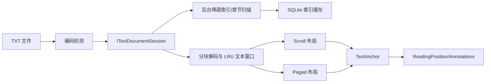

# HNovaReader 第一阶段技术架构

> 状态：Phase 1 架构基线  
> 范围：只支持本地 TXT；不包含后续阶段实现代码

## 1. 最终结论

| 议题 | 决策 |
|---|---|
| 数据持久化 | 使用 SQLite；关系数据用 EF Core SQLite，应用偏好用 `settings.json` |
| 数据访问 | ViewModel 不接触 DbContext；Service 通过 `IDbContextFactory` 使用短生命周期 DbContext；不再叠加通用 Repository/UoW |
| 大型 TXT | 不使用 `File.ReadAllText`；采用 FileStream/RandomAccess 分块解码、稀疏 byte↔char 检查点、后台索引和有界视口缓存 |
| MemoryMappedFile | 第一版不采用；保留为性能基准证明 FileStream 不足之后的优化项 |
| 编码检测 | BOM → 严格 UTF-8 → 多位置采样检测/评分 → 用户默认值；始终允许手动切换并按书保存 |
| 章节目录 | 多个可版本化正则规则逐行检测，与大文件扫描共用一次后台顺序读取，结果增量显示并缓存 |
| 阅读布局 | Scroll 与 Paged 共享 `ITextDocumentSession` 和 `TextAnchor`，各自拥有独立的布局控制器和缓存 |
| 阅读位置 | 持久化 Unicode UTF-16 code-unit `CharacterOffset`；像素滚动位置只在当前 View 内临时使用 |
| 标注定位 | Offset/Length + 原文 + 前后文 + 文件版本；文件变化时使索引失效并明确警告，不假装位置仍精确 |
| 书架虚拟化 | List 使用回收型 `VirtualizingStackPanel`；Grid 第一版使用“虚拟化行 + 行内卡片”，避免非虚拟化 WrapPanel |
| UI 导航 | MainWindow 是 Shell，轻量 `INavigationService` 切换 ViewModel，DataTemplate 映射 View，不在 ViewModel 创建 View |
| 项目数量 | 一个 WPF 项目 + 一个测试项目；按 Feature 与基础设施职责分目录，不拆成多层解决方案 |

这套方案的核心原则是：数据库存“用户数据”，TXT 文件仍是内容事实来源；Reader Engine 暴露可定位的文本会话，而不是一整个 `string`。

## 2. SQLite、JSON 与 EF Core

### 2.1 为什么 SQLite 值得使用

即使书籍只有几千本，数据也已经不是简单配置：

- Book 与 Tag 是多对多；Book 与 Author/Series 是关系。
- Bookmark、Highlight、Note、ReadingPosition 都需要按 BookId 查询、级联清理和事务保存。
- 书库页面需要组合筛选、排序、搜索和唯一约束。
- 批量导入需要“要么写入完整记录，要么回滚”的原子性。

用 JSON 会把索引、关系完整性、并发写入、局部更新和故障恢复都变成自研代码。单文件 SQLite 仍然完全离线，部署成本很低，因此比 JSON 更适合作为书库数据库。

### 2.2 为什么选 EF Core SQLite

选择 EF Core 8 的原因不是数据量，而是模型关系：多对多映射、导航属性、迁移、唯一索引和 LINQ 查询能显著减少样板。直接 `Microsoft.Data.Sqlite` 只有在查询极少、模型非常扁平时才更轻；本项目后续标注与筛选会让手写 SQL/映射的维护成本更高。

保持轻量的边界：

- 不创建 Generic Repository、UnitOfWork、Domain Event 或多项目 Clean Architecture。
- DbContext 本身已经承担 Unit of Work；由 `LibraryService`、`AnnotationService` 等用例服务直接使用。
- WPF 是长生命周期进程，不保留全局 DbContext；使用 `IDbContextFactory<HNovaReaderDbContext>` 为每次操作创建短生命周期上下文。
- 批量导入按小批次使用显式事务，避免 SQLite 长写锁。

SQLite 对 `decimal` 的比较/排序没有原生支持，[EF Core SQLite 限制文档](https://learn.microsoft.com/en-us/ef/core/providers/sqlite/limitations)也建议在不要求高精度时使用 `double`。SeriesIndex 只表达 `1`、`2.5` 这类顺序，因此存为 `double?`，显示时用受控格式；不为它引入客户端排序。

### 2.3 SQLite 与 settings.json 的边界

SQLite 保存：

- Books、Authors、Series、Tags、BookTags
- ReadingPositions、Bookmarks、Highlights、Notes
- 章节/稀疏文本索引的版本和缓存元数据

`settings.json` 保存：

- 应用 Dark/Light/System 主题
- Reader Light/Dark/Sepia 主题
- 字体、字号、行距、段距、边距、最大正文宽度
- Scroll/Paged 模式、默认编码、书库目录和默认导入行为
- 窗口尺寸、侧栏状态等设备/UI 偏好

`settings.json` 采用版本号和原子替换写入。文件损坏时回退默认值并保留坏文件供诊断。数据库和设置均放在 `%LocalAppData%\HNovaReader`，不写程序安装目录。

## 3. 推荐数据模型

下面是概念模型，不是最终迁移代码：

- `Book`
  - `Id`
  - `FilePath`、`NormalizedFilePath`（唯一索引）
  - `StorageMode`（OriginalLocation / ManagedCopy）
  - `Title`、`Description`、`CoverPath`
  - `AuthorId`、`SeriesId`、`SeriesIndex: double?`
  - `IsFavorite`、`DateAddedUtc`、`LastOpenedAtUtc`
  - `FileSize`、`LastWriteTimeUtc`、`FileEncoding`
- `Author`、`Series`、`Tag`、`BookTag`
- `ReadingPosition`
  - BookId 唯一、CharacterOffset、ByteOffsetHint
  - Progress、ChapterTitleSnapshot、UpdatedAtUtc
  - AnchorPrefix、AnchorSuffix、FileVersion
- `Bookmark`
  - CharacterOffset、PreviewText、ChapterTitleSnapshot
  - AnchorPrefix、AnchorSuffix、FileVersion、CreatedAtUtc
- `Highlight`
  - StartOffset、Length、SelectedText、Style
  - AnchorPrefix、AnchorSuffix、FileVersion、CreatedAtUtc
- `Note`
  - HighlightId 可空；或 CharacterOffset 单点锚定
  - Content、AnchorPrefix、AnchorSuffix、FileVersion、CreatedAtUtc/UpdatedAtUtc
- `BookTextIndex`
  - BookId、Encoding、FileVersion、PatternVersion、TotalCharacterCount、IsComplete
- `TextCheckpoint`
  - BookTextIndexId、CharacterOffset、ByteOffset
- `Chapter`
  - BookTextIndexId、Title、Level、StartOffset、EndOffset

`FileVersion` 第一版由 FileSize + LastWriteTimeUtc 组成。索引完成后可以附加便宜的采样指纹，但导入时不对全部文件计算完整 SHA-256。

自定义封面复制到 `%LocalAppData%\HNovaReader\covers`，数据库保存应用管理后的路径；同时生成固定像素宽度的缩略图到 `cache`。这样用户移动原始图片不会使封面失效。TXT 是否复制则完全由导入时的 OriginalLocation/ManagedCopy 选项决定，绝不擅自移动。

## 4. 300MB TXT 的读取架构

### 4.1 不采用整本字符串或整本 FlowDocument

300MB 文件解码为 UTF-16 字符后通常会占用更多内存；再转换为 Paragraph、Run、TextPointer 等 WPF 对象会进一步放大。一次性 `ReadAllText` 和整本 `FlowDocument` 都会导致首次打开延迟、GC 压力和 UI 卡顿。

[WPF FlowDocument](https://learn.microsoft.com/en-us/dotnet/desktop/wpf/advanced/flow-document-overview)擅长回流、分页和选择，但它应只承载当前有界文本窗口，而不是作为整本书的内容仓库。

### 4.2 内容管线



打开过程：

1. 读取文件元数据，比较 FileSize/LastWriteTimeUtc。
2. 从头、中、尾少量采样进行编码判定；BOM 始终优先。
3. 如果缓存索引的文件版本、编码和索引规则版本匹配，直接复用。
4. 优先读取当前锚点附近的有界窗口，让正文尽快可见。
5. 后台顺序扫描其余内容，同时生成章节、总字符数和稀疏检查点；通过进度对象增量更新目录。
6. 视口只保留当前窗口与少量前后窗口，使用按字符容量限制的 LRU，而不是无限缓存。

底层默认使用异步 `FileStream` 做顺序扫描，使用 [.NET RandomAccess](https://learn.microsoft.com/en-us/dotnet/api/system.io.randomaccess)按已知字节偏移加载窗口。MemoryMappedFile 能高效提供随机文件视图，但它仍然不能解决 UTF-8/GB18030 的多字节边界、字符偏移映射和 WPF 对象量；第一版引入它只会增加资源生命周期与错误处理复杂度，因此暂不使用。若后续基准显示随机窗口读取成为瓶颈，再替换底层实现，不改变 Reader Session 接口。

### 4.3 byte offset 与 character offset

两者不能混用：

- byte offset 用于在原始文件中快速定位，受编码影响。
- character offset 是解码后文本的语义位置，用于阅读进度和标注。

HNovaReader 把 CharacterOffset 定义为：去除 BOM 后、保留原始换行符的 .NET UTF-16 code-unit 索引，类型为 `long`。这与 .NET string/WPF 文本的基本索引模型一致，也能覆盖超过 2GB 字符空间。

为避免从文件开头扫描到目标字符，后台扫描每隔一定字符数在安全换行边界记录 `{CharacterOffset, ByteOffset}`。读取目标范围时先二分查找最近检查点，再从该 byte offset 增量解码到目标 character offset。ReadingPosition 还可以保存 `ByteOffsetHint`，但只有文件版本和编码完全匹配时才能使用；它是加速提示，不是持久语义锚点。

## 5. 中文 TXT 编码检测

传统中文编码无法做到百分之百自动判断，尤其短文本中的 GB18030 与 Big5 可能都能“合法解码”。正确产品策略是可解释的自动建议 + 明确的人工覆盖。

检测顺序：

1. 精确 BOM：UTF-8、UTF-16 LE/BE，并识别 GB18030 签名。
2. 使用抛异常 fallback 验证采样是否为严格 UTF-8；不是简单检查是否出现替换字符。
3. 对文件头为主、并辅以中部/尾部的有限样本使用 UTF.Unknown。该项目基于 Mozilla 检测器，并声明支持 GB18030 与 Big5，见 [UTF.Unknown 项目说明](https://github.com/CharsetDetector/UTF-unknown)。
4. 对候选编码执行质量评分：非法序列、替换字符、异常 NUL/控制字符、可疑字符比例；用户设置的默认编码只作为低置信度平局决胜。
5. UI 显示当前编码；低置信度时给出非阻塞提示。用户可切换 UTF-8、GB18030、Big5、UTF-16，并选择“为本书记住”。

应用启动时注册 `CodePagesEncodingProvider.Instance`，以获得 GB18030/Big5 等传统代码页支持，参见 [.NET EncodingProvider](https://learn.microsoft.com/en-us/dotnet/api/system.text.encodingprovider)。

编码变更会改变字符流，必须使章节、分页、检查点缓存失效，并提示已有阅读位置/标注需要复核。

## 6. TXT 章节索引

`IChapterDetector` 接收带绝对 CharacterOffset 的完整文本行，内部持有多个 `IChapterPattern`，而不是一个万能正则。第一版内置：

- 中文章/回：中文数字、全角/半角阿拉伯数字。
- 中文卷/部/篇/集：作为较高目录层级。
- 英文 Chapter：阿拉伯数字或简单罗马数字，忽略大小写。

规则先限制“单独一行、合理最大长度、标题形态”，再匹配，降低正文中“第一章”字样的误报。`ChapterInfo` 至少包含 Title、Level、StartOffset、EndOffset；EndOffset 在发现下一章或扫描结束时补齐。

索引不阻塞首次阅读：首个内容窗口显示后，后台扫描同一 FileStream；每找到一批章节就报告进度。扫描同时生成 byte↔char 检查点，避免对 300MB 文件读两遍。缓存键包含 FileVersion、Encoding 和 ChapterPatternVersion；任一变化都重新索引。取消只停止后台工作，不关闭已经可读的当前窗口。

## 7. Scroll 与 Paged 双模式

### 7.1 共同边界

`IReaderEngineFactory` 根据文件类型选择 `IReaderEngine`；第一版只有 TxtReaderEngine。引擎打开后返回 `ITextDocumentSession`，负责：

- 按 CharacterOffset 读取有界文本范围。
- 暴露章节和索引进度。
- 在 char 与 byte 检查点之间定位。
- 检测源文件版本变化。

ReaderViewModel 持有当前 `TextAnchor` 和通用设置；Scroll/Paged 各自由 `IReadingModeController` 管理表现状态。切换模式时只交换同一个 CharacterOffset，不交换像素偏移或页码。

### 7.2 Scroll 模式

几个原生选择的取舍：

| 选择 | 结论 |
|---|---|
| 单个 TextBlock | 轻，但无原生文本选择/高亮，整本布局仍不可接受 |
| 单个 RichTextBox/FlowDocument | 选择和高亮好，但整本对象树与重排成本不可接受 |
| 大量段落 TextBlock + 普通 ItemsControl | 会创建大量 Visual，且跨块选择困难 |
| 从零实现完整文本控件 | 性能上限高，但第一版成本和风险过大 |

第一版采用“有界滑动 FlowDocument”：使用样式化的只读 RichTextBox 承载锚点前后有限文本窗口。接近窗口边缘时异步加载相邻段并裁剪远端段；映射表记录每个 Run/Paragraph 对应的源 CharacterOffset，使选择和高亮能转换为全书绝对位置。滚动条表达当前窗口，底部独立进度条表达全书进度。这个方案利用 WPF 已有选择/排版能力，同时避免整本对象树。

窗口换页、加载和裁剪属于 View/reading surface 行为；文件读取、锚点和保存仍在 ViewModel/Service。任何临时 `VerticalOffset` 只用于窗口更新时保持画面稳定，绝不入库。

### 7.3 Paged 模式

Paged 模式对当前锚点附近的有界 FlowDocument 使用 WPF 文档分页能力，不对整本书预分页。分页协调器懒计算当前页，并预取少量相邻页；每个页边界记录绝对 CharacterOffset。

分页缓存键 `LayoutSignature` 包含：

- 内容 FileVersion、Encoding
- viewport 宽/高、DPI
- 字体族、字号、字重、行距、段距
- 正文最大宽度和边距

Resize 或排版参数变化时：先保存当前页首个可见 CharacterOffset，清空旧 LayoutSignature 的页边界，从该锚点重新排版。页码是派生 UI 状态，不是阅读位置。ReaderTheme 若只改变颜色无需重分页；改变字体度量时必须重分页。

不实现 3D 翻页或整本预分页，只提供上一页/下一页及方向键、PageUp/PageDown。

## 8. ReadingPosition 与标注锚点

### 8.1 阅读位置

主锚点是第一个稳定可见字符的 CharacterOffset。保存采用 debounce 和生命周期触发相结合：阅读中低频保存，切书、返回书库和正常退出时立即刷新；不要每次滚动事件都写数据库。

建议的 `TextAnchor`：

- CharacterOffset（权威位置）
- ByteOffsetHint（仅用于未变化文件的快速恢复）
- Bias（锚点显示在页首/视口中部等）
- ChapterTitleSnapshot
- Prefix/Suffix 少量上下文
- FileVersion

阅读进度在总字符数已知后用 `CharacterOffset / TotalCharacterCount` 计算。索引尚未完成时可显示 byte 比例的近似值，但最终持久状态由字符总数校正。

### 8.2 Bookmark、Highlight、Note

仅有 `StartOffset + Length + SelectedText` 对未变化文件足够，对被编辑文件不够。第一版保存冗余上下文：

- Bookmark：Offset + Preview + Prefix/Suffix。
- Highlight：StartOffset + Length + SelectedText + Prefix/Suffix。
- Note：关联 Highlight，或保存独立 TextAnchor。
- 所有记录带创建时 FileVersion。

打开时若 FileSize/LastWriteTimeUtc 改变：

1. 旧 byte hint、章节索引和分页缓存立即失效。
2. 显示一次清晰但非阻塞的“原始 TXT 已修改”提示。
3. 旧 offset 只作为近似位置并 clamp 到合法范围；标注标记为“需要复核”。
4. 第一版不做全书 diff 或自动批量迁移。未来可用 SelectedText + Prefix/Suffix 在旧位置附近进行有限搜索，但不得静默覆盖原锚点。

这满足“识别问题并诚实提示”，同时避免把复杂文本版本控制塞入第一版。

## 9. 1000–5000 本书的 WPF 虚拟化

List View 使用 ListView/ListBox + `VirtualizingStackPanel`：开启 UI virtualization、recycling、内容滚动，并避免破坏虚拟化的外层 ScrollViewer。官方资料说明 WPF 不提供内置数据虚拟化，且内置虚拟化主要是单轴，见 [WPF 控件性能指南](https://learn.microsoft.com/en-us/dotnet/desktop/wpf/advanced/optimizing-performance-controls)。

Grid View 不使用普通 WrapPanel，因为它会为全部 BookCard 创建容器。第一版采用稳定、易测试的“按行虚拟化”：

- 根据可用宽度计算列数。
- 将过滤/排序后的书籍投影为 `BookRow`，每行 N 本。
- 外层 ListBox 用垂直 `VirtualizingStackPanel` 回收整行；行内只有少量卡片。
- 宽度跨过列数断点时重新分行，并通过 BookId 恢复选择和大致滚动锚点。

5000 条书籍元数据可以一次载入轻量 DTO，但封面必须懒加载。CoverService 按目标像素宽度解码、`BitmapCacheOption.OnLoad` 后关闭文件、Freeze 图像，并使用有上限的内存 LRU + 磁盘 thumbnail cache。卡片模板保持扁平，Hover 操作区只在容器已实现时存在。

如果后续实测按行投影无法满足可变卡片尺寸，再实现或引入经过验证的 VirtualizingWrapPanel；不在第一版先承担双轴虚拟化复杂度。

## 10. UI Navigation 与工程组织

MainWindow 只负责 Shell、窗口级拖拽入口和必须属于 View 的 WindowChrome 行为。自定义标题栏优先使用 `WindowChrome` 保留系统 resize、snap、DPI 和多显示器行为，不用脆弱的纯 `WindowStyle=None` 手工模拟。

导航结构：

- `ShellViewModel.CurrentPage`
- `INavigationService.NavigateAsync(Route, parameter)`、`GoBackAsync()`
- Route：Library、Series、Tags、Reader(bookId)、Settings
- ViewModel 由 DI 创建；App 级 DataTemplate 将 ViewModel 映射为 View
- 导航服务管理返回栈和可释放页面；ViewModel 不 new View，也不操作 ContentControl

推荐目录采用轻量 feature-first 结构：

```text
HNovaReader.sln
HNovaReader/
├─ App.xaml
├─ Data/
│  ├─ Entities/
│  ├─ Configurations/
│  └─ HNovaReaderDbContext.cs
├─ Features/
│  ├─ Shell/
│  ├─ Library/
│  ├─ Reader/
│  ├─ Series/
│  ├─ Tags/
│  └─ Settings/
├─ Readers/
│  ├─ Abstractions/
│  └─ Txt/
├─ Services/
├─ Infrastructure/
│  ├─ Files/
│  ├─ Navigation/
│  └─ Persistence/
├─ Resources/
│  ├─ Styles/
│  ├─ Themes/
│  └─ Icons/
└─ Converters/
HNovaReader.Tests/
```

它仍然只有两个项目，但把 Library/Reader 相关 View、ViewModel 和局部组件放在同一 Feature 内，减少巨大的全局 Views/ViewModels 文件夹。跨 Feature 的 Reader Engine、数据库和平台服务保留明确边界。

关键服务包括：

- `ILibraryService`、`IImportService`
- `ITextEncodingDetector`、`IChapterDetector`
- `IReaderEngineFactory`、`ITextDocumentSession`
- `IReadingPositionService`、`IAnnotationService`
- `ISettingsService`、`ICoverService`
- `IFileExplorerService`、`IRecycleBinService`
- `INavigationService`、`IThemeService`

删除磁盘文件必须经过明确二次确认，再由 `IRecycleBinService` 移入 Windows 回收站；“从书库移除”只删除数据库记录。这两个命令、文案和服务方法都保持分离。

## 11. 第一版主动舍弃

明确不做：

- EPUB/PDF/MOBI/AZW3/漫画格式及其占位 UI。
- 在线书城、在线元数据、云同步、账号、AI。
- TXT 全文搜索和 SQLite FTS。
- 每日/累计阅读时长、趋势、次数等行为统计。
- 全文件 SHA-256 去重；第一版以规范化绝对路径为唯一约束。
- 源文件修改后的全量 diff、无提示自动锚点迁移。
- 整本 TXT 常驻内存、整本预分页、首次打开前完成全量索引。
- 3D 翻页、复杂动画、大量毛玻璃/阴影。
- 默认采用 MemoryMappedFile、自研完整排版引擎或双轴虚拟化面板。
- 用户自定义章节正则编辑器、复杂目录层级编辑器。
- 多窗口 Reader、插件系统、企业级 Repository/UoW/Event Bus。

这些舍弃不关闭未来入口：格式扩展位于 IReaderEngine，全文搜索可在 Library/Search 服务后加入，锚点恢复可在 TextAnchorResolver 后增强。

## 12. 实现阶段的验证门槛

除需求列出的单元测试外，每个相关阶段需增加：

- 使用合成大文件验证首屏不等待全量扫描、取消有效、内存有上限。
- UTF-8/UTF-16/GB18030/Big5 的 BOM、无 BOM、错误字节和手动覆盖用例。
- 稀疏检查点在多字节字符与 CRLF 边界上的 byte↔char 往返测试。
- Scroll/Paged 切换后 CharacterOffset 保持；字体/Resize 后仍落在同一语义锚点附近。
- 文件版本变化使所有派生缓存失效，且标注进入“需要复核”状态。
- 5000 个 Book DTO 下已实现的 BookCard 数量与可见行同阶，而不是 5000。
- “从书库移除”绝不触碰源文件；“删除磁盘文件”走回收站服务并要求二次确认。

Phase 2 只创建可编译运行的 Shell、DI、主题、导航和数据库基础，不提前塞入 Reader 业务；随后严格按需求的 Phase 3–10 逐步实现。

